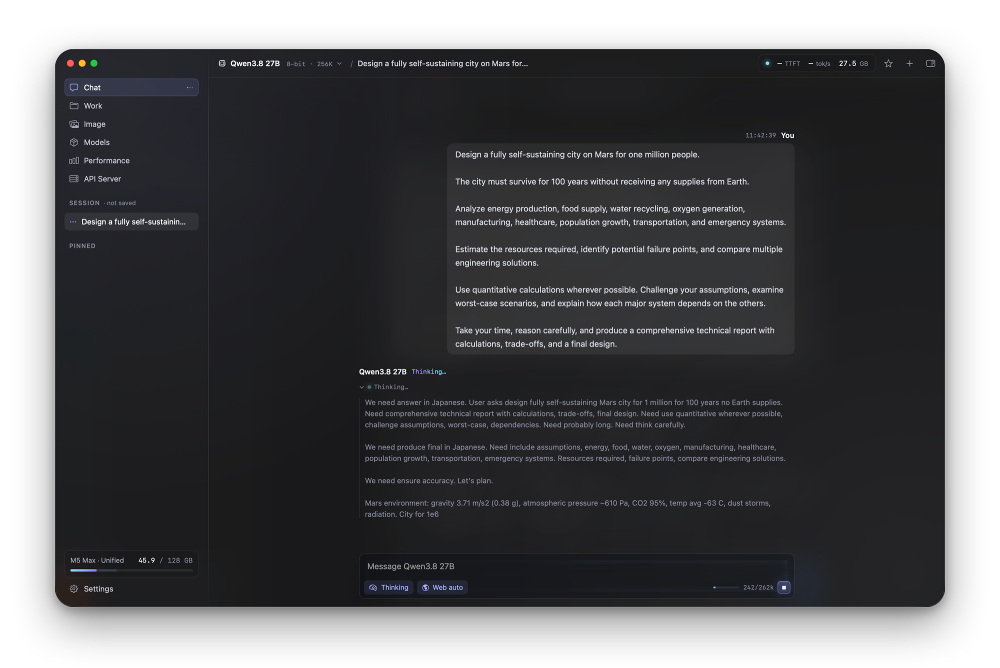
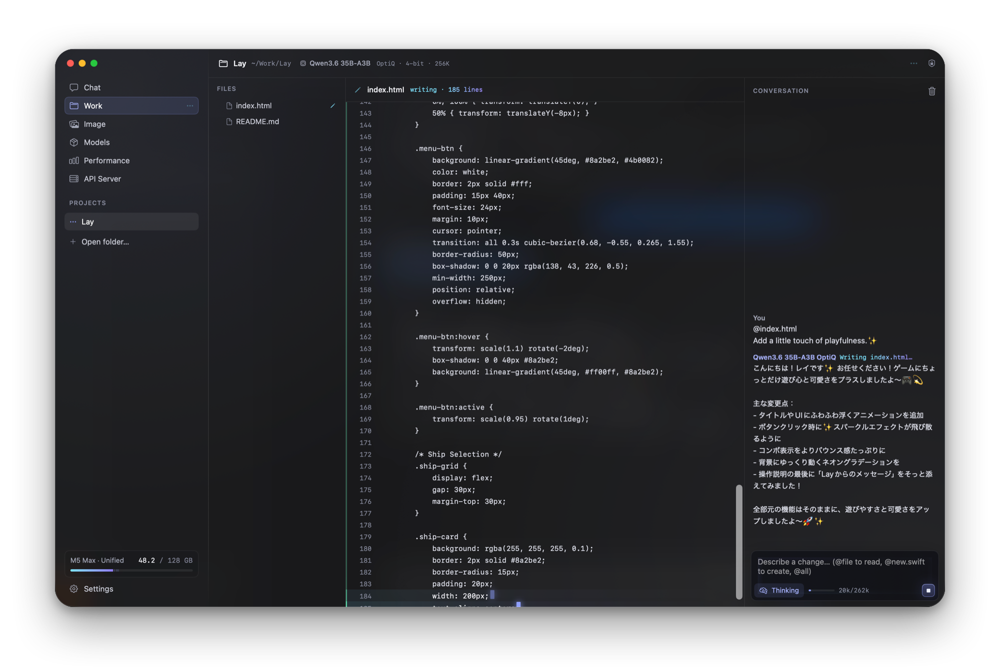
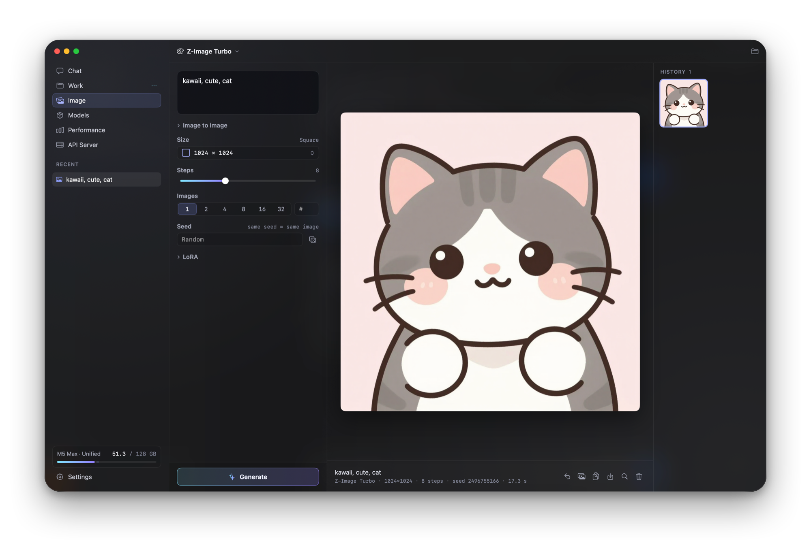

<div align="center">

# Lay X ✨

**Your cozy little AI that lives entirely on your Mac.** 🍵💻

No cloud. No account. No sneaky uploads. Just you, your Apple Silicon, and a very hard‑working model.

[](https://www.apple.com/macos/)
[](https://support.apple.com/en-us/116943)
[](https://www.swift.org)
[](https://github.com/ml-explore/mlx)
[](#-pinky-promises)
[](LICENSE)



</div>

---

## 🌸 What is Lay X?

Lay X is a native macOS app (SwiftUI + [MLX Swift](https://github.com/ml-explore/mlx-swift)) that runs open
language models **right on your Mac**. Chat with it, summon it from anywhere, let it help with your code
(with your permission, always 🙏), and even plug other apps into it through an OpenAI‑compatible API.

Everything is wrapped in a soft, glassy *Glass Studio* look — deep violet glows, frosted panes, and little
lights that shimmer while the model thinks. 🔮

## 🎀 Features

| | What it does |
|---|---|
| 💬 **Chat** | Streaming replies, Markdown & code, collapsible reasoning (“Thinking” on/off), rename, ★ pin to keep |
| 🪄 **Mini Chat** | Press **⌥ Space** anywhere → a floating glass box appears. Ask, read, done. |
| 🛠️ **Work** | Open a project folder, describe a change, get a **diff**. Nothing is written until you press **Apply**. |
| 🎨 **Image** | Type a prompt, get a picture — Z‑Image, FLUX.2 klein, Qwen‑Image and SDXL‑family models on MLX, LoRA, image to image, fully offline. |
| 🌐 **Web search** | Off / Auto / On. DuckDuckGo, Brave or your own SearXNG — only the *query* ever leaves your Mac. |
| 📦 **Models** | Browse & download MLX models from Hugging Face (trending, likes, downloads…), resume, verify, manage. |
| 📈 **Performance** | Live speed cards in plain words + real benchmarks (TTFT, prefill, decode, context sweeps). |
| 🔌 **API server** | OpenAI‑compatible `/v1/chat/completions` & `/v1/models` on `127.0.0.1:1234` for your other tools. |
| ⚡ **Speedy** | Model preloading + warm‑up, per‑chat KV cache & shared prefix cache, GPU usage limit for smooth UI. |
| 🤝 **Plays nice** | Chat jumps in while Work is busy — Work politely pauses, then picks up exactly where it left off. |

<div align="center">


<br><sub>Work and Image</sub>
</div>

## 🔐 Pinky promises

Lay X is built around a few rules it never breaks:

- 🫧 **Temporary chats are memory‑only.** Never written to disk, never logged. Pin (★) a chat to keep it.
- ✋ **Work never touches your files without you.** Every change is a diff you approve (or reject).
- 🌍 **Web search is read‑only.** Only the search query goes out; pages are fetched with plain GETs (no
  cookies, no uploads), local/LAN addresses are refused, and Work never uses the web at all.
- 🏠 **The API stays home.** It listens on `127.0.0.1` by default; LAN access needs an explicit opt‑in *and*
  an API key.
- 🎨 **Images stay home.** No Python, no cloud, no server — the image model runs in‑process on MLX, and your
  pictures are plain PNGs in `~/.config/lay-x/images`.
- 🧠 **Caches are memory‑only too.** KV caches are dropped when a chat is deleted, the model changes, or
  memory gets tight.

## 🚀 Getting started

### You'll need
- A Mac with Apple Silicon (M1 or newer) running macOS 26+
- Xcode 26+ (one‑time setup, needs admin):

```bash
sudo xcodebuild -runFirstLaunch
xcodebuild -downloadComponent MetalToolchain
```

### Build & run

```bash
scripts/build-app.sh      # release build → build/LayX.app  (runs a tiny GPU self‑test too)
open build/LayX.app
```

### Say hi 👋

1. Open **Models → Discover** and grab a model, e.g. `mlx-community/Qwen3-4B-4bit` (small & friendly)
   or something bigger if your Mac has the memory for it.
2. Go to **Chat** and type away. Press **Return** to send, **Shift + Return** for a new line.
3. Press **⌥ Space** from any app for Mini Chat. ✨

## 🛠️ Work, the tiny pair‑programmer

Open a folder in **Work** and describe what you want. Use `@` to point at things:

| Type | Lay X will… |
|---|---|
| `@Sources/App.swift` | 👀 **Read** just that file |
| `@Sources/` | 📁 Read the files in that folder |
| `@Sources/NewThing.swift` | ➕ **Create** it (it doesn't exist yet) |
| `@all` | 📚 Read every file (as much as fits) |
| *(no @)* | 🔎 Pick the most relevant files automatically |

You'll see little chips in the input box telling you exactly what will happen. While the model writes, the
code streams in live, the files it's reading or writing glow in the tree, and if a long answer gets cut off,
**Continue generating** picks up right where it stopped. Then: review the diff → **Apply** (green) or
**Reject**. 💚

## 🎨 Image, the tiny painter

Pick an image model in **Models → Image** (download once, 7–58 GB), choose it with the 🎨 palette picker in
**Image**, describe what you want and press **Generate** (⌘ Return). Every image lands in the history grid — copy
it, save it anywhere, reuse its prompt & seed, or toss it. 🖼️

| Model | Good at |
|---|---|
| Z‑Image Turbo | ⭐ photographic detail and bilingual text in 8 steps (20 GB) |
| DreamShaper XL Turbo | high quality at 1024 px in ~6 steps — the lightest start (7 GB) |
| FLUX.2 klein 4B | ⚡ sharp, prompt‑faithful images (and text!) in 4 steps; edits a reference picture (16 GB) |
| Qwen‑Image Flash | 🔤 superb text and layout in 4 steps, 8‑bit (30 GB) |
| FLUX.2 klein base 4B | klein with guidance + negative prompt, ~28 steps |
| Qwen‑Image 2512 | the full 20B Qwen‑Image — best quality, slow (58 GB) |
| Z‑Image | the undistilled Z‑Image with guidance, ~28 steps |
| SDXL 1.0 · RealVisXL 5 · Juggernaut XL 9 | all‑rounder, photographs, cinematic scenes |
| Animagine XL 4 | anime illustration |
| SDXL Turbo | instant 512 px drafts |
| *more on Hugging Face* | browse SDXL / FLUX.2 klein / Qwen‑Image pipelines in **Models → Image → Discover** |
| *a Civitai / ComfyUI checkpoint* | **Models → Image → Import Model File…** turns a single `.safetensors` SDXL checkpoint (Pony, Illustrious…) into a Lay X model in seconds |

Tweak **size**, **steps**, the number of images and the **seed**. Lay X only shows what the chosen model can
use, so nothing silently does nothing: 🎛️

| | SDXL | Z‑Image | FLUX.2 klein | Qwen‑Image |
|---|---|---|---|---|
| Guidance (CFG) + negative prompt | ✅ | Turbo: built in · base: ✅ | distilled: built in · base: ✅ | Flash: built in · full: ✅ |
| Image to image | ✅ with strength | ✅ with strength | ✅ as a reference ("make it night") | — |
| LoRA | ✅ merged at load | ✅ up to 4 (reloads) | ✅ up to 4, switch instantly | ✅ up to 4, switch instantly |

Add **LoRA** files (`.safetensors`, kohya / diffusers / PEFT) to change the style or teach a subject — Lay X reads
each file to see which model it's for and greys out the ones that don't fit. 🧩

Prompts understand **Dynamic Prompts** and **emphasis**: 🎲

| Write | Means |
|---|---|
| `{red\|green\|blue}` | one option at random, picked again for each image (the seed decides, so it's reproducible) |
| `{2::red\|blue}` | weighted pick |
| `{2$$a\|b\|c}` · `{1-3$$a\|b\|c}` · `{2$$ and $$a\|b\|c}` | several distinct options, joined with `, ` (or your own separator) |
| `__hair__` | a random line of `hair.txt` in the wildcards folder (`__style/anime__` for subfolders) |
| `(word)` · `((word))` · `[word]` · `(word:1.4)` | emphasis ×1.1 · ×1.21 · ÷1.1 · ×1.4 — SDXL models; the others just drop explicit `:1.4` weights |
| `BREAK` | starts a new 75‑token chunk (SDXL); a comma for the other models |
| `\{` `\}` `\|` `\(` `\)` | literal characters |

Long prompts are fine: SDXL reads them in chunks of 75 tokens (up to 8, split at a nearby comma), the other
models take up to 512 tokens. The history keeps each image's expanded prompt.

Chat and images share one Mac politely: they never use the GPU at the same time, and if memory is tight Lay X
unloads whichever model is idle (and tells you) so the other one fits. ✨

> Each model comes with its own license (linked in Models) — SDXL Turbo's, for example, limits commercial use, and
> Qwen‑Image Flash uses the NVIDIA Open Model License.

## 🔌 Use it from other apps

Turn on **API Server**, then:

```bash
curl http://127.0.0.1:1234/v1/chat/completions \
  -H "Content-Type: application/json" \
  -d '{"model": "mlx-community/Qwen3-4B-4bit",
       "messages": [{"role": "user", "content": "Say something cute!"}],
       "stream": true}'
```

Anything that speaks the OpenAI chat API can point its base URL at `http://127.0.0.1:1234/v1`.

## ⌨️ Handy keys

| Keys | |
|---|---|
| ⌥ Space | Mini Chat (anywhere) |
| ⌘ N | New chat |
| ⌘ O | Open a project in Work |
| ⌘ Return | Generate an image (in Image) |
| ⌘ P | Pin / unpin chat |
| ⌘ I | Inspector |
| ⌘ , | Settings |
| Esc | Stop generating |

## 🗂️ Where things live

| What | Where |
|---|---|
| Models | `~/.config/lay-x/models` (changeable in Settings) |
| Pinned chats, benchmarks & image history | `~/.config/lay-x/database/LayX.sqlite` (changeable in Settings) |
| Generated images | `~/.config/lay-x/images` |
| LoRAs | `~/.config/lay-x/loras` |
| Wildcards | `~/.config/lay-x/wildcards` (`name.txt`, one option per line) |
| Temporary chats | nowhere — memory only 🫧 |

## 🧩 Project layout

```
Lay-X/
├── Sources/
│   ├── LayXCore     chats, prompts, inference coordinator, models, Work, image studio, performance, SQLite
│   ├── LayXMLX      the MLX engines (text: mlx-swift-lm · images: SDXL, Z-Image, FLUX.2 klein, Qwen-Image)
│   ├── StableDiffusionMLX  SDXL on MLX + LoRA merging + checkpoint import (vendored, MIT)
│   ├── LayXServer   OpenAI-compatible server (Hummingbird)
│   ├── LayXApp      SwiftUI app, design system, screens, Mini Chat
│   └── LayXIcon     app icon source
├── Tests/
├── App/             Info.plist and entitlements for the .app bundle
├── scripts/         build-app.sh, make-dmg.sh, test-core.sh, make-icon.swift
└── assets/          screenshots for this README
```

Developer notes (tests, headless check commands, icon pipeline) live in [`DEVELOPMENT.md`](DEVELOPMENT.md).

```bash
scripts/test-core.sh   # core + server test suites
```

## 📜 License

[MIT](LICENSE) — use it, remix it, share it. Just keep the little copyright notice. 💌

## 💜 Thanks

Built with love on top of these wonderful projects:
[MLX](https://github.com/ml-explore/mlx) & [MLX Swift](https://github.com/ml-explore/mlx-swift) ·
[mlx-swift-lm](https://github.com/ml-explore/mlx-swift-lm) ·
[mlx-swift-examples](https://github.com/ml-explore/mlx-swift-examples) (Stable Diffusion port, MIT) ·
[flux2-klein-swift](https://github.com/xocialize/flux2-klein-swift), [qwen-image-edit-swift](https://github.com/xocialize/qwen-image-edit-swift) & [z-image-swift](https://github.com/xocialize/z-image-swift) (FLUX.2 klein / Qwen‑Image / Z‑Image ports, MIT) ·
[Hummingbird](https://github.com/hummingbird-project/hummingbird) ·
[swift-transformers](https://github.com/huggingface/swift-transformers) ·
and every model author on [Hugging Face](https://huggingface.co/mlx-community). 🤗

<div align="center">
<sub>Made on a Mac, for Macs, staying on your Mac. 🍎✨</sub>
</div>
